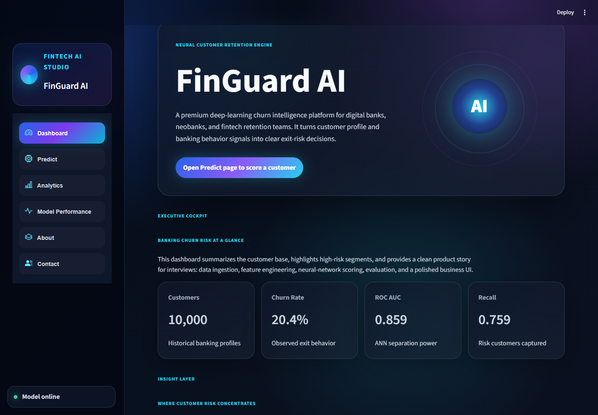

# FinGuard AI — Bank Customer Churn Predictor

A Python and Streamlit application that estimates a bank customer's exit risk with a TensorFlow/Keras neural network. Explore historical customer patterns, score a profile, and inspect measured model performance in one local application.

**College presentation:** [Download the 18-slide PowerPoint](presentation/FinGuard_AI_College_Presentation.pptx)

**Learn the project:** [Complete guide](PROJECT_GUIDE.md) · [Windows setup and troubleshooting](LOCAL_SETUP.md)



## Features

- Score one customer from ten profile and banking attributes.
- Display an estimated exit probability and a Stable, Watchlist, or High Risk category.
- Explore churn by country, age, products, balance, salary, and activity status.
- Inspect test metrics, a ROC curve, a confusion matrix, and training curves.
- Run locally with the included dataset, trained network, and preprocessing files.

The app uses historical CSV data. Form submission performs inference without retraining or connecting to a live bank. Suggested actions use hand-written rules. The Contact page is a demonstration form without email delivery or persistent storage.

## Quick start on Windows

**Prerequisites:** Git and 64-bit Python **3.12**. The tested setup uses Windows and TensorFlow's CPU package; a GPU is not required.

```powershell
Set-Location D:\
git clone https://github.com/ShabbirMhowwala/Bank-Churn-Rate-Predictor.git
Set-Location .\Bank-Churn-Rate-Predictor
py -3.12 -m venv .venv
.\.venv\Scripts\python.exe -m pip install -r requirements-local-lock.txt
.\Run_Project.bat
```

Open **http://127.0.0.1:8501**. For later use, double-click `Run_Project.bat`. Keep its window open while using the app. Press **Ctrl+C**, or double-click `Stop_Project.bat`, to stop it. After restarting Windows, run the launcher again.

The trained artifacts are included, so everyday use requires **no retraining**. Core predictions and charts work without an external API or internet connection after installation. Optional fonts/icons and external links may still need internet access.

Manual launch:

```powershell
.\.venv\Scripts\python.exe -m streamlit run app.py
```

`.streamlit/config.toml` sets address `127.0.0.1`, port `8501`, a dark theme, and usage-statistics collection to off. The server listens on this computer only. `.env.example` is illustrative; the code does not automatically load `.env`.

`requirements-local-lock.txt` records the complete tested Windows/Python 3.12 environment. `requirements.txt` lists direct dependencies and matches the important serialization-library versions. Other platforms require their own compatibility checks; the Windows lock includes `tensorflow_intel`.

## Data and preprocessing

`data/bank_customer_churn.csv` contains **10,000 customers**, **14 columns**, and **2,037 exits**: a historical churn rate of **20.37%**. The supplied data has no missing values. The target `Exited` is `1` for exited and `0` for stayed.

| Input group | Fields |
|---|---|
| Customer profile | CreditScore, Geography, Gender, Age |
| Banking relationship | Tenure, Balance, NumOfProducts |
| Engagement and income | HasCrCard, IsActiveMember, EstimatedSalary |

The pipeline drops `RowNumber`, `CustomerId`, and `Surname`, then adds:

| Engineered feature | Calculation |
|---|---|
| BalanceSalaryRatio | Balance / estimated salary |
| CreditScoreAgeRatio | Credit score / age |
| BalancePerProduct | Balance / product count |
| TenureByAge | Tenure / age |
| IsHighValueInactive | Balance above the reference median and inactive membership |

For these calculations, zero salary, product count, and tenure become `1`. The preprocessor standardizes 13 numeric features and one-hot encodes three countries and two gender categories, yielding **18 model inputs**. Inference reuses the saved scaler, encoder, and reference balance median to match training.

The dataset does not establish a prediction time horizon or monetary currency. Its original collection provenance is not documented in this repository.

## Neural network

```text
18 inputs
Dense(64, ReLU)
Batch normalization
Dropout(0.25)
Dense(32, ReLU)
Dropout(0.20)
Dense(16, ReLU)
Dense(1, sigmoid)
```

| Training parameter | Value |
|---|---|
| Task | Supervised binary classification |
| Total model parameters | 4,097 |
| Optimizer / learning rate | Adam / 0.001 |
| Loss | Binary cross-entropy |
| Maximum epochs / batch size | 45 / 64 |
| Test split | 20%, stratified, random state 42 |
| Validation split | 15% of the remaining 80% |
| Split counts | 6,800 training, 1,200 validation, 2,000 test |
| Class imbalance | Balanced class weights |
| Early stopping | Maximize validation AUC, patience 8 |
| Weight selection | Restore best validation-AUC weights |
| Evaluation threshold | Exit probability at least 0.50 |
| Included model's run | 32 epochs before early stopping |

Only the train/test split has a fixed seed in the current script. Neural-network initialization and training are not fully seeded, so a new training run can produce different results.

### Retraining

Stop the app and back up `models/` and the training charts before replacing them.

```powershell
.\.venv\Scripts\python.exe train_model.py --epochs 45 --batch-size 64
```

Training writes the network, preprocessor, feature list, metrics, test predictions, classification report, and evaluation PNGs. Restart the app to reload cached artifacts. Keep the dataset, model, and preprocessor together as a compatible set.

## Verified results

The included model was trained locally on 23 October 2026. Reloading its saved file reproduces the saved test probabilities within floating-point tolerance.

| Test metric | Result |
|---|---:|
| Accuracy | 77.40% |
| Churn precision | 46.61% |
| Churn recall | 75.92% |
| ROC AUC | 0.85898 |

| Actual / predicted | Stayed | Exited |
|---|---:|---:|
| Stayed | 1,239 | 354 |
| Exited | 98 | 309 |

The model catches **309 of 407 churn cases**, misses **98**, and raises **354 false alarms**. An always-stayed baseline achieves **79.65% accuracy** but **0% churn recall**. The ANN's accuracy is below that baseline, while its recall shows that it identifies many churners. No comparison with trained logistic-regression or tree-based baselines has been completed.

| Display band | Score |
|---|---|
| Stable | Below 0.35 |
| Watchlist | At least 0.35 and below 0.65 |
| High Risk | At least 0.65 |

These display bands differ from the 0.50 evaluation threshold. A customer's score is not an accuracy percentage or a guaranteed outcome. Probability calibration has not been established.

## Technology stack

| Area | Technologies |
|---|---|
| Runtime | Python 3.12, venv, pip |
| Neural network | TensorFlow 2.18.0, Keras 3.14.1 |
| Data and preprocessing | Pandas 2.2.3, NumPy 2.0.2, scikit-learn 1.9.0 |
| Application | Streamlit 1.66.1, HTML/CSS |
| Charts | Plotly 6.7.0, Matplotlib 3.10.0, Seaborn 0.13.2 |
| Storage | CSV, Joblib 1.4.2, HDF5 |
| UI components | streamlit-option-menu, streamlit-lottie, streamlit-extras |

## Repository map

| Location | Purpose |
|---|---|
| `app.py`, `pages/` | Home page and six application pages |
| `train_model.py` | Model training and evaluation |
| `utils/` | Preprocessing, scoring, caching, and charts |
| `components/`, `assets/` | Shared UI, CSS, animation, screenshots, and evaluation plots |
| `data/` | Historical data and four sample input profiles |
| `models/` | Saved network, preprocessor, and test results |
| `presentation/` | Editable college PowerPoint |
| `.streamlit/config.toml` | Shared local settings, without credentials |
| `Run_Project.bat`, `Stop_Project.bat` | Windows start and stop controls |
| `verify_local.py` | Model and application verification |
| `streamlit_app/` | Earlier alternative dashboard implementation |
| `PROJECT_GUIDE.md`, `PROJECT_GUIDE.html` | Detailed learning and viva guide |
| `LOCAL_SETUP.md` | Local operation and troubleshooting |

## Verification

```powershell
.\.venv\Scripts\python.exe -m pip check
.\.venv\Scripts\python.exe verify_local.py
```

The script checks model reload consistency, saved metrics, sample profiles, single-customer feature consistency, all seven screens, prediction submission, empty analytics filters, and one training step on a separate in-memory network. It writes `local_verification.json` and leaves the deployed model unchanged.

## Limitations and next steps

- **Preprocessing leakage:** the trainer calculates the balance median before the test split and fits the scaler before separating validation data. Split raw records first and fit all statistics on the training subset in a future version.
- **False alarms:** fewer than half of current churn alerts are true positives. Tune the threshold against an explicit objective using independent validation.
- **Explanations:** the app uses rules and dataset correlations, rather than model-specific feature attribution. SHAP remains future work.
- **Model selection:** compare simpler classifiers under the same clean split before choosing an ANN.
- **Generalization:** the data covers three countries and limited historical attributes. Live banking validation, drift monitoring, and calibrated probabilities are not included.

This is an educational project for demonstrating the ML workflow and local deployment. Its scores have not been validated for real-world customer decisions.

## College demonstration

1. Show customer count and historical churn rate.
2. Score a profile from `data/sample_customers.csv` on the Predict page.
3. Explain preprocessing and the 64/32/16 network.
4. Explain precision, recall, and false alarms on Model Performance.
5. Finish with deployment settings and planned improvements.

Use the [18-slide PowerPoint](presentation/FinGuard_AI_College_Presentation.pptx) for presenting and the [project guide](PROJECT_GUIDE.md) for detailed explanations and viva preparation.
